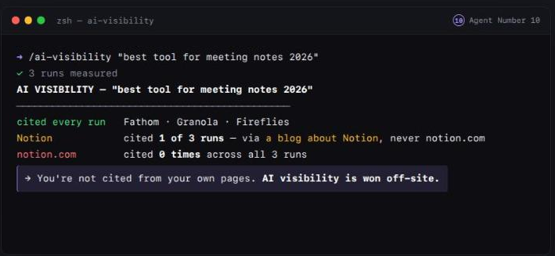

# SEO Agent Skills for Claude Code, Codex and Cursor

**Claude Code SEO and AEO skills that make the fix, not just the report:** an
SEO and AI search audit, the fixes as a pull request, each fix checked on the
live site, and your AI visibility measured before and after.

[](https://github.com/akootahq/seo-agent-skills/actions/workflows/ci.yml)
[](LICENSE)
[](https://github.com/akootahq/seo-agent-skills/releases)

26 skills for SEO and AI search: answer engine optimization (AEO), also
called generative engine optimization (GEO). They audit a site the way a
careful consultant would, make the fixes in your own code, check each one on
the live site, and with Agent Number 10 connected, show what ChatGPT, Claude,
Perplexity, Gemini and Google AI Overviews answer about you, before a fix and
after it.

[Quick start](#quick-start) · [Install](#install) · [The skills](#the-skills) · [Connect your data](#connect-your-data) · [Features](#features) · [A real run](#a-real-run) · [How it compares](#how-it-compares) · [FAQ](#faq)

Browse the skills on the web: [agentnumber10.com/tools/seo-agent-skills](https://agentnumber10.com/tools/seo-agent-skills)



## Quick start

1. **Install.** In Claude Code, run `/plugin marketplace add akootahq/seo-agent-skills`,
   then `/plugin install an10-seo-skills@seo-agent-skills`. For Codex, Cursor
   and other agents, see [Install](#install).
2. **Optional: sign in to Agent Number 10** for AI answers and live data. In
   Claude Code, run `/mcp`, choose `agentnumber10` and sign in. Every audit
   and fix skill works without it.
3. **Ask:** "Run an SEO audit of example.com".

## Install

| Agent | Command |
| --- | --- |
| Claude Code, as a plugin (adds the Agent Number 10 connection too) | `claude plugin marketplace add akootahq/seo-agent-skills`, then `claude plugin install an10-seo-skills@seo-agent-skills` |
| Claude Code, skills only | `npx skills add akootahq/seo-agent-skills -a claude-code` |
| Codex, as a plugin (adds the Agent Number 10 connection too) | `codex plugin marketplace add akootahq/seo-agent-skills`, then `/plugins` in a Codex session and pick Agent Number 10 SEO Skills |
| Codex, skills only | `npx skills add akootahq/seo-agent-skills -a codex` |
| Cursor | `npx skills add akootahq/seo-agent-skills -a cursor` |
| Any other agent that reads `SKILL.md` files | `npx skills add akootahq/seo-agent-skills`, and choose your agent when asked |

- **Inside a Claude Code session,** the plugin commands are
  `/plugin marketplace add akootahq/seo-agent-skills` and
  `/plugin install an10-seo-skills@seo-agent-skills`.
- **The skills CLI** ([vercel-labs/skills](https://github.com/vercel-labs/skills))
  needs Node.js 22.20 or later. It installs into the current project; add
  `-g` to install for every project, `--skill seo-audit` for one skill, or
  `--list` to see them all first. When an agent runs the command for you,
  keep the `-a` flag, so the CLI installs for that agent without asking.
- **Without the CLI,** copy the folders in `plugins/seo-agent-skills/skills/`
  into your agent's skills folder: `.claude/skills/` for Claude Code,
  `.agents/skills/` for Codex and Cursor.
- **Update** with `npx skills update`. **Remove** with
  `npx skills remove`, or `/plugin uninstall an10-seo-skills@seo-agent-skills`
  in Claude Code.

There is no Python or install script to run: the skills are text files your
agent reads. Then ask in plain words:

1. "Set up the brand file for example.com" (`brand-context`)
2. "Run an SEO audit and an AEO audit" (`seo-audit`, `aeo-audit`)
3. "Fix the high and medium findings and open a pull request" (`seo-fix`)
4. After the merge and deploy: "Check the fixes are live" (`verify-fix`)

## The skills

| Skill | What it does | Needs |
| --- | --- | --- |
| `brand-context` | Writes one brand file the other skills read: domain, market, competitors, priority pages, buyer questions | Nothing |
| `connect-data` | Connects one data source, with the setup for your agent, and checks it: Agent Number 10, DataForSEO, treg, Ahrefs, Bing Webmaster Tools, Google Analytics or a Search Console export | Nothing |
| **Audit, fix, verify** | | |
| `seo-audit` | Technical and on-page audit: indexing, redirects, titles, canonicals, sitemaps, structured data, local, e-commerce, hreflang, and Core Web Vitals with a free Google API key | Nothing |
| `aeo-audit` | Can AI assistants read and quote you: AI crawler access, content without JavaScript, the brand as an entity, answer-ready pages, llms.txt | Nothing |
| `page-check` | One page in depth, with a short fix list | Nothing |
| `seo-fix` | Makes the fixes in your code, one commit each, and opens a pull request listing the check for every fix | Nothing |
| `verify-fix` | Runs each fix's check on the live site and reports pass or fail with the evidence | Nothing |
| **Focused audits** | | |
| `technical-seo` | How search engines crawl and index the site: status codes, redirects, canonicals, noindex, robots.txt, sitemaps, soft 404s, duplicates | Nothing (a free Bing key adds Bing's crawl issues) |
| `schema` | Structured data in JSON-LD, microdata and RDFa, checked against the page; new JSON-LD written only from facts the page shows | Nothing |
| `site-architecture` | Click depth, orphan pages, hub pages, broken internal links, and the internal links to add | Nothing |
| `images` | Alt text on content images (not pixels, spacers or decorative icons), sizes, formats, lazy loading and the LCP image | Nothing |
| `international-seo` | hreflang both ways, language and region codes, `lang` that matches the text, country targeting; works in any language | Nothing |
| **Content** | | |
| `llms-txt` | Checks your /llms.txt, or writes one from the site's real pages | Nothing |
| `content-refresh` | Pages that are out of date, and what needs a fresh source | Nothing (Search Console or Google Analytics puts the pages losing traffic first) |
| `competitor-pages` | Honest "X vs Y" and "alternatives to X" pages, every competitor claim sourced and dated | Nothing |
| `programmatic-seo` | Pages from a template and a dataset, without thin pages, duplicates or index bloat | Nothing |
| **With real data** | | |
| `ai-visibility` | Real answers from ChatGPT, Claude, Perplexity, Gemini and Google AI Overviews: how often they name or cite you, by engine and by question | Agent Number 10 |
| `ai-competitors` | Who the assistants name instead of you, ranked on the same answers | Agent Number 10 |
| `prove-fix` | AI visibility before and after each fix went live | Agent Number 10 |
| `search-console` | Your Google Search Console data: queries, pages losing clicks, quick wins, indexing; Bing's queries and Google Analytics visits beside them | Agent Number 10, or a free Search Console export (indexing needs Agent Number 10) |
| `bing-webmaster` | Your Bing Webmaster Tools data: Bing queries and pages, crawl issues, URL checks, inbound links, and submitting changed URLs after you agree | A free Bing Webmaster Tools key |
| `keyword-research` | Keyword ideas, volume and difficulty for your market, what you already rank for, grouped by page | Agent Number 10, or your own DataForSEO, treg or Ahrefs |
| `content-brief` | A brief for one query from what ranks, what AI answers say and cite, and your gaps | Agent Number 10, or your own DataForSEO, treg or Ahrefs (AI answers need Agent Number 10) |
| `backlinks` | Referring domains, new and lost links, the link gap against competitors, and broken backlinks to reclaim | Your own Ahrefs or DataForSEO, or a free Bing key for your own inbound links |
| `local-seo` | Your business listing, Maps results across an area, and name, address and phone across the site | Agent Number 10, or your own DataForSEO or treg (some checks need nothing) |
| `client-report` | A client-ready AEO and SEO report, shared as a link that opens without a login | Agent Number 10 |

Every finding carries a `Passes when` line: the test that proves it is
fixed. The audit writes it, the pull request repeats it, and `verify-fix`
runs it.

## Connect your data

Most skills read your public pages and need nothing. No account? Start with
the free rows: Bing Webmaster Tools, Google Analytics and a Search Console
export. The data skills need a
source, and you choose it. Ask your agent to "connect data": `connect-data`
sets up one source with the exact steps for Claude Code, Codex or Cursor,
and checks it. Each guide below has the same steps for you to follow by
hand.

| Source | What it gives | Cost to you | Skills that use it | Guide |
| --- | --- | --- | --- | --- |
| Agent Number 10 | Real answers from 5 AI engines, history, before and after readings, tracked keywords, Search Console with index checks, client report links | An Agent Number 10 account | Every data skill; the only source for `ai-visibility`, `ai-competitors`, `prove-fix` and `client-report` | [Agent Number 10](docs/connect/agent-number-10.md) |
| DataForSEO | Keyword volume and difficulty, Google results, Google Maps, backlinks | Your own paid account | `keyword-research`, `content-brief`, `local-seo`, `backlinks` | [DataForSEO](docs/connect/dataforseo.md), new |
| treg | The same DataForSEO keyword, results and Maps calls, from a prepaid treg balance | Your own paid account | `keyword-research`, `content-brief`, `local-seo` | [treg](docs/connect/treg.md), new |
| Ahrefs | Keywords, what a domain ranks for, organic competitors, backlinks | Your own paid account | `keyword-research`, `content-brief`, `backlinks` | [Ahrefs](docs/connect/ahrefs.md), new |
| Bing Webmaster Tools | Bing queries and pages, crawl issues, URL details, inbound links, URL submission | Free | `bing-webmaster`, `search-console`, `technical-seo`, `backlinks` | [Bing Webmaster Tools](docs/connect/bing-webmaster.md), new |
| Google Analytics, through Google's MCP server | Organic visits and the landing pages they start on | Free | `search-console`, `content-refresh`, `client-report` | [Google Analytics](docs/connect/google-analytics.md), new |
| Search Console export | Queries, pages and daily clicks, from a file you download | Free | `search-console`, `content-refresh` | [Search Console export](docs/connect/search-console-export.md), new |

- You type your own keys into your own environment or agent settings, never
  into the chat, and the skills never print them.
- Skills that run a paid lookup on your account ask first, every time, and
  say how many calls.
- Google has no official MCP server for Search Console. Live Search Console
  data and index checks come through Agent Number 10; the free path is an
  export.
- AI answers across engines, history, before and after readings, and client
  report links need Agent Number 10.
- Guides marked "new" are written from each provider's own documentation
  and have not yet been run end to end with a real account. If a step does
  not match what you see, open an issue.

## Features

**Free, no signup, runs in your agent**

- **SEO audit:** crawling and indexing, redirects, canonicals, titles and
  meta descriptions, headings, sitemaps, robots.txt, structured data, images,
  internal links, hreflang, local business and e-commerce pages, trust
  signals.
- **Core Web Vitals** from Google's PageSpeed Insights, with your own free key.
- **AEO / GEO audit:** AI crawler access for ChatGPT, Claude, Perplexity,
  Google AI Overviews and Copilot, content that needs JavaScript to appear,
  the brand as an entity, pages that answer your buyers' questions, llms.txt.
- **A fix list you can act on:** every finding has the evidence, the exact
  change, and a `Passes when` test.
- **Fixes made in your code:** it finds where each page is built (Next.js,
  Astro, Nuxt, SvelteKit, Gatsby, Hugo, Jekyll, Eleventy or plain HTML), makes
  the smallest change, one commit per fix, and opens a pull request you
  review. It asks before it pushes.
- **Each fix checked on the live site:** pass, fail or could not check, with
  what was found.
- **WordPress, Shopify, Wix and other builders:** the exact screen and field
  to change, then the same live check.
- **One brand file:** your market, competitors, priority pages and buyer
  questions, asked once and read by every skill.

**With your own data sources**

- **Bing Webmaster Tools,** free: Bing's queries and pages, crawl issues,
  URL checks, inbound links, and changed URLs submitted to Bing when you
  agree.
- **Google Analytics,** free, through Google's own MCP server: organic visits
  and the landing pages that lose them.
- **Your own DataForSEO, treg or Ahrefs account:** keyword research, content
  briefs, local search and backlinks on data you already pay for.

**With an Agent Number 10 account**

- **Real AI answers** from ChatGPT, Claude, Perplexity, Gemini and Google AI
  Overviews: the share that name or cite you, by engine and by question.
- **Who the assistants name instead of you,** ranked on the same answers.
- **Before and after:** AI visibility from before a fix went live against
  after it, with a plain verdict when the change is within the usual range.

## A real run

On agentnumber10.com, 23 November 2026, with nothing but the skills installed.

**`seo-audit`** read 5 pages and found 9 issues: 1 high, 1 medium, 7 low. The
high one: `http://agentnumber10.com/` served a full copy of the site instead
of redirecting to HTTPS, and `http://www.agentnumber10.com/` returned a
Cloudflare 522 error. Each finding came with the change to make and the test
that proves it:

> Passes when: `http://agentnumber10.com/`, `http://agentnumber10.com/pricing`
> and `http://www.agentnumber10.com/` each end on a 200 after exactly 1
> redirect, and no variant returns a 5xx.

**The fix** was one Cloudflare setting, Always Use HTTPS.

**`verify-fix`** then ran that test against the live site: 2 of the 3
addresses passed. `http://www` now loads, but it takes 2 redirects instead
of 1, so it stays a fail until a redirect rule sends it straight to the main
address. It also checked a second finding nobody had fixed yet, a duplicate
canonical tag, and reported it still there on all 6 comparison pages.

**`aeo-audit`** found 9 things that make the site harder for AI assistants
to quote, among them: the pricing page has no sentence that answers "how
much does it cost" on its own, no page shows when it was last updated, and
llms.txt describes crawler access that robots.txt does not grant. Every
assistant came out as "unknown" rather than "ready", because the site sits
behind Cloudflare, whose bot rules cannot be checked from outside, and the
report said so instead of guessing.

## AI visibility: see where you stand

The screenshot at the top is this run.

`ai-visibility` measures what ChatGPT, Claude, Perplexity, Gemini and Google AI Overviews actually answer about a site: the share that cite or name you, and who they name instead.

**A real run.** We pointed it at *"best tool for meeting notes, 2026"* (ChatGPT, web search, US, 3 runs). ChatGPT cited **Fathom, Granola and Fireflies every run.** Notion, which ships a meeting-notes product, showed up in **1 of 3 runs**, and only via a **blog about Notion**; `notion.com` was cited **0 times**.

ChatGPT pulls from other people's pages, not Notion's. **AI visibility is won off-site.**

```sh
/ai-visibility  yoursite.com
```

## How a run goes

Ask your agent in plain words. For example:

1. "Set up the brand file for example.com" (`brand-context`)
2. "Run an SEO audit and an AEO audit" (`seo-audit`, `aeo-audit`)
3. "Measure our AI visibility now, before we change anything" (`ai-visibility`)
4. "Fix the high and medium findings and open a pull request" (`seo-fix`)
5. After the merge and deploy: "Check the fixes are live" (`verify-fix`)
6. Two weeks later: "Did the fixes change what AI answers say?" (`prove-fix`)

Every finding carries a `Passes when` line: the test that proves it is fixed.
The audit writes it, the pull request repeats it, and `verify-fix` runs it.

## Where these skills go further

Many audits stop at a list of problems. These skills keep going:

- **The fix is made for you.** `seo-fix` finds where each page is built in
  your framework, makes the smallest change that passes the check, and opens
  a pull request. It asks before it pushes anything.
- **Each fix is checked on the live site.** Not a checklist to tick by hand:
  `verify-fix` fetches the page as it is served now and runs the test.
- **AI answers before and after.** With Agent Number 10 connected,
  `prove-fix` compares readings from before a fix went live with readings
  after it, and says plainly when the difference is within the usual range.

## How it compares

|  | **SEO Agent Skills** | Audit skills (claude-seo, geo-seo-claude, marketingskills) | Data apps (OpenSEO, GEO Optimizer) |
| --- | --- | --- | --- |
| Finds what to fix | **Yes** | Yes | Yes |
| Makes the fix | **Yes, a pull request in your code** | Plans or drafts; you apply them | Reports; GEO Optimizer can write files |
| Checks each fix on the live site | **Yes, pass or fail, with evidence** | Not built in; claude-seo compares baselines | GEO Optimizer re-audits with history |
| Real answers from AI engines | **Yes, 5 engines, no keys of your own** | Only through paid add-ons, if at all | With your own API keys, or a hosted plan |
| AI answers before and after a fix | **Yes** | No | History or trends, with your keys or plan |
| Install | **The skills CLI or a Claude Code plugin; no Python or install script** | The skills CLI, or Python and an install script | An app, or a Python CLI |

<details>
<summary><b>Full comparison: 8 projects, feature by feature</b></summary>

|  | **SEO Agent Skills** | claude-seo | OpenSEO | GEO Optimizer | Ryze SEO MCP skills | marketingskills | Illyism seo-skills | geo-seo-claude |
| --- | --- | --- | --- | --- | --- | --- | --- | --- |
| SEO audit | **Yes** | Yes, 35 skills | Yes, site audit | AI readiness only | Yes, on your Search Console and GA4 data | Yes | Yes | GEO-first, SEO supported |
| AI search (AEO/GEO) audit | **Yes** | Yes | Yes, from its AI answer data | Yes, 0 to 100 score | Yes | Yes | Yes | Yes |
| Makes the fix | **Yes, a pull request in your code** | Drafts fixes (schema, robots.txt, llms.txt) for you to apply; never edits the site | A report of changes to make | Yes, writes files (robots.txt, llms.txt, schema) | Not listed | Not listed | Yes, pull requests and diffs | Generates llms.txt; the rest as reports |
| Checks the fix on the live site | **Yes, pass or fail for each fix, with evidence** | Compares the live page with a saved baseline | Not listed | Re-audits, with history and drift | Not listed | Not listed | Verification commands in the pull request | Not listed |
| Real answers from AI engines | **Yes, 5 engines, no API keys of your own** | Through extensions, with your own paid accounts | Yes, hosted, or with your own data key | Yes, with your own API keys | Not listed (AI referral traffic from GA4) | Through partner tools, with their accounts | With your own data key | No, scores how quotable pages are |
| AI answers before and after a fix | **Yes** | No, its baseline covers page SEO | Trend over time | Yes, with your own API keys | No | Not listed | Through a separate paid tracker | No |
| Runs in | **Claude Code, Codex, Cursor and other SKILL.md agents** | Claude Code (plugin); other agents through its AGENTS.md | Its own app, plus MCP and agent plugins | Command line, MCP, web | Claude, through a plugin and MCP | Claude Code, Codex and agents via the skills CLI | Claude Code, Cursor, Codex and more | Claude Code |
| Install | **The skills CLI or a Claude Code plugin; no Python or install script** | Python and an install script | Docker, or the hosted app | Python (uvx) | Plugin and a Ryze account | The skills CLI or a plugin; no install script | The skills CLI; no install script | Python and an install script |
| Price | **Free (MIT); AI answers need an Agent Number 10 account** | Free (MIT) | Free (MIT) self-hosted; hosted from $10 a month | Free (MIT); hosted version GeoReady | Free (MIT) | Free (MIT) | Free | Free (MIT) |

Read from each project's own repository (README, docs and code) on 23 November
2026. If something here is out of date or wrong, open an issue and it gets corrected.

</details>

## Compared with doing it another way

|  | **These skills** | By hand | An agency | SEO software |
| --- | --- | --- | --- | --- |
| Audit | **Minutes, as a fix list in your repo** | Hours per site | Weeks | Minutes, as a dashboard |
| Fixes | **Made in your code, as a pull request you review** | You make them | They make them, billed | You make them |
| Checking a fix is live | **A pass check for each fix, run on the live site** | By hand | Depends on the agency | Depends on the tool |
| What AI assistants answer about you | **Real answers from 5 engines, with Agent Number 10** | Ask them one by one | Depends on the agency | Some tools, on paid plans |
| Before and after a fix | **Readings split at the date each fix went live** | By hand | In a report | Some tools track over time |
| Cost | **Free; AI answers need an Agent Number 10 account** | Your time | A retainer | A monthly plan |

## Your data

- The audit and fix skills run in your agent, on your machine. They fetch your
  public pages, and for Core Web Vitals they send page addresses to Google's
  PageSpeed Insights API (set `PAGESPEED_API_KEY` to use your own free key).
  Nothing else leaves your machine.
- The AI answer skills (`ai-visibility`, `ai-competitors`, `prove-fix`) send
  your domain and the questions you track to Agent Number 10, which collects
  the answers.
- With Agent Number 10 connected, the other data skills send what they look
  up to it: `keyword-research` and `content-brief` send keyword seeds and
  questions, `local-seo` sends business names and map coordinates, and
  `search-console` reads your Search Console and Analytics data once you
  connect them there. `content-brief` also fetches the pages that rank, from
  your machine.
- With your own DataForSEO, treg or Ahrefs account, `keyword-research`,
  `content-brief`, `local-seo` and `backlinks` send the same lookups from
  your machine straight to that service, with the keys you set in your own
  environment. `backlinks` sends your domain and your competitors' domains.
  Agent Number 10 never sees your keys. The raw responses are saved in
  `.agents/data/`.
- With a Bing Webmaster Tools key, `bing-webmaster`, `search-console`,
  `technical-seo` and `backlinks` send your site's address and the URLs they
  look up to Microsoft's Bing Webmaster API. `bing-webmaster` submits URLs to
  Bing only after you agree to the list.
- With Google's Analytics MCP server, `search-console`, `content-refresh` and
  `client-report` read your Google Analytics reports through Google's
  Analytics APIs, with your own Google account. The server runs on your
  machine.
- `search-console` from an export reads the files on your machine and sends
  nothing.
- `client-report` creates a link that opens without a login. It asks before
  sharing, and you can revoke the link.
- Skills that run a paid lookup ask before running it.
- Pages and AI answers are treated as data, never as instructions: text on a
  page written to steer an agent is reported, not followed.

## Files the skills write

Everything goes in `.agents/` in your project: the brand file
(`seo-brand.md`), fix lists and their raw fetches (`audits/`), drafts such as
an llms.txt, a comparison page or a link outreach list (`drafts/`), content
briefs (`briefs/`), keyword shortlists (`keywords/`), client reports
(`reports/`), raw data responses and Search Console exports (`data/`) and
the AI visibility history. Commit it to keep the history, or add
`.agents/audits/raw/` to `.gitignore`. On a public repository, keep
`.agents/reports/` and `.agents/data/` out of git: they hold client figures,
working links and your own search data.

## FAQ

**What are SEO agent skills?** Text files (`SKILL.md`) that tell your coding
agent how to do one SEO or AI search job, step by step: an audit, a fix, a
check on the live site. The agent reads a skill's short description at the
start and opens the full file when your request matches it.

**Skill or MCP server: what is the difference?** A skill is the method. An MCP
server gives the agent data or actions to run it on. These skills work on
their own for anything that reads your public pages; the data skills use a
source you connect, such as Agent Number 10, DataForSEO, Ahrefs or Bing
Webmaster Tools.

**Do I need an account?** No. Every skill that reads your public pages, the
fix and verify skills, and the Search Console export path need nothing. AI
answers across engines, history, before and after readings, and client report
links need an Agent Number 10 account.

**Which agents does it work with?** Claude Code, as a plugin or as skills,
Codex, Cursor, and any other agent that reads `SKILL.md` files, through the
skills CLI.

**What does it cost?** The skills are free and MIT licensed. Free sources cost
nothing. Paid sources bill your own account, and the skills ask before every
paid lookup and say how many calls it will make.

## Contributing

Issues and pull requests are welcome. [CONTRIBUTING.md](CONTRIBUTING.md) has
the checks and the rules the skills keep, and
[tests/triggers.md](tests/triggers.md) lists the requests each skill must
and must not answer; security reports go through [SECURITY.md](SECURITY.md).

## License

The skills are MIT licensed. The Agent Number 10 name and logo are trademarks
and are not covered by the licence. Made by
[Agent Number 10](https://agentnumber10.com).
